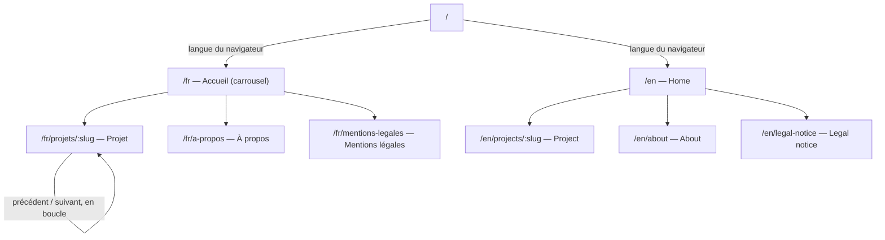
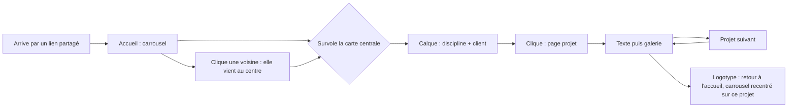

# Architecture de contenu & UX — Mandolina, graphiste

Version 0.3 — 18/11/2026 — **statut : à valider** (v0.3 : île de navigation ; v0.2 : page projet d'après la maquette de la cliente : bandeau, présentation sur deux colonnes, galerie en mosaïque)

S'appuie sur le PRD v0.3 (pages, carrousel, bilingue, Dashility), le territoire de marque v0.1 (ton : « je » + vouvoiement) et la DA v0.1 (« Aplats » : calque coloré, menu plein écran, motion posée). Aucune décision visuelle ici : les wireframes ne montrent que la structure.

---

## 1. Arborescence et adresses



| Page | FR | EN |
|---|---|---|
| Accueil | `/fr` | `/en` |
| Projet | `/fr/projets/lutece-logo` | `/en/projects/lutece-logo` |
| À propos | `/fr/a-propos` | `/en/about` |
| Mentions légales | `/fr/mentions-legales` | `/en/legal-notice` |
| Page introuvable | toute adresse inconnue sous `/fr` | toute adresse inconnue sous `/en` |

- `/` redirige vers `/fr` ou `/en` selon la langue préférée du navigateur (français par défaut).
- Le **slug** d'un projet est le même dans les deux langues (celui de Dashility), pour que le changement de langue garde le même projet.
- Le **choix de langue** du menu mène à la même page dans l'autre langue. Un projet sans version anglaise complète n'existe pas en anglais (règle de Dashility) : le lien de langue mène alors à l'accueil anglais.
- Adresses sans `/` final ni `.html`.

---

## 2. Parcours

### P1 — Visiteur curieux : voir le travail



1. Arrive sur `/fr` (ou directement sur un projet partagé).
2. Le carrousel montre trois projets ; la carte centrale est la plus grande.
3. Fait défiler (clic sur une voisine, molette, flèches du clavier, doigt).
4. Survole la carte centrale : l'aplat montre la discipline et le client.
5. Clique : page projet. Lit le texte, parcourt la galerie.
6. Continue avec « Projet suivant », ou revient à l'accueil par le logotype : le carrousel est recentré sur le dernier projet vu.

### P2 — Client freelance : juger, puis contacter

1. Parcourt deux ou trois projets comme P1.
2. Ouvre le menu, puis **À propos**.
3. Lit la présentation, puis clique sur l'adresse mail (ouvre sa messagerie) ou télécharge le book PDF dans sa langue.

### P3 — Mandolina : publier un projet

1. Dans Dashility, crée une entrée « Projet » : nom, discipline, client, texte, couverture, galerie, couleur, ordre ; en français puis en anglais.
2. Clique sur « Publier ».
3. Le site se reconstruit et se met en ligne en quelques minutes ; le projet apparaît dans le carrousel à sa place.

---

## 3. Contenu par page

### Île de navigation (toutes les pages)

Fixée en haut au centre, par-dessus le contenu (DA §5).

| Élément | Rôle |
|---|---|
| Logotype « MANDOLINA » | Lien vers l'accueil de la langue courante ; texte alternatif « Mandolina, retour à l'accueil » |
| Bouton « ••• » | Ouvre l'île ; nom accessible « Ouvrir le menu » / « Fermer le menu », `aria-expanded` |

Une fois ouverte, l'île montre :

| Ordre | Élément | Rôle |
|---|---|---|
| 1 | À propos | Page À propos |
| 2 | Mentions légales | Page Mentions légales |
| 3 | FR / EN | Même page dans l'autre langue ; la langue courante est indiquée (`aria-current`) |

C'est un menu déroulant, pas une fenêtre : la page reste utilisable. À l'ouverture, le focus va au premier lien ; l'île se referme avec « × », `Échap` (le focus revient au bouton), un clic hors de l'île, quand le focus la quitte, et à chaque changement de page.

### Accueil

| Section | Contenu | Message clé |
|---|---|---|
| Carrousel | Les projets publiés, triés par le champ « Ordre » ; une carte = l'image de couverture | Le travail, tout de suite |
| Calque de la carte centrale | Discipline (titre souligné) et client | Ce qu'est ce projet, pour qui |

Titre de page `h1` présent mais masqué visuellement : « Mandolina, graphiste — projets ».

### Projet

| Ordre | Section | Contenu |
|---|---|---|
| 1 | Bandeau | Pleine largeur, à la couleur du projet : « Client — Discipline » (`h1`, ex. « Lutèce Destroyeuses — Identité visuelle ») |
| 2 | Présentation | Texte de présentation (texte riche) sur deux colonnes sur ordinateur, une sur mobile |
| 3 | Galerie | Les images de la galerie en mosaïque : chacune en pleine largeur, en moitié ou en tiers de la largeur de contenu, selon son champ « Largeur » ; chaque image a son texte alternatif. Galerie vide : la couverture seule |
| 4 | Navigation | « Projet précédent » et « Projet suivant », avec le nom du projet visé ; en boucle |

La couverture sert au carrousel et à l'aperçu de partage ; la page projet montre la galerie. Le nom du projet (ex. « Lutèce — Logo ») reste le titre de l'onglet et le libellé de la navigation précédent / suivant.

### À propos

| Ordre | Section | Contenu |
|---|---|---|
| 1 | Titre | « À propos » (`h1`) |
| 2 | Présentation | Accroche (« Je suis Mandolina, graphiste. ») et texte |
| 3 | Contact | « Pour un projet, écrivez-moi : » + adresse mail (lien `mailto:`) |
| 4 | Book | « Télécharger mon book (PDF) », fichier de la langue courante, avec son poids |

### Mentions légales

Titre (`h1`), puis : éditrice (nom, contact), hébergeur, propriété intellectuelle des visuels, absence de cookies. Texte riche géré dans Dashility.

### Page introuvable

« Cette page n'existe pas. » + lien « Retour aux projets ». Header présent.

---

## 4. Modèle de contenu dans Dashility

Types créés par le développeur dans l'espace de Mandolina. « Trad. » : saisi en FR et en EN.

**Projet** (collection)

| Champ | Type Dashility | Trad. | Obligatoire | Usage |
|---|---|---|---|---|
| Nom | Texte court | oui | oui | `h1` de la page projet, navigation précédent / suivant, titre de l'onglet (ex. « Lutèce — Logo ») |
| Discipline | Texte court | oui | oui | Titre du calque (ex. « Identité visuelle ») |
| Client | Texte court | non | oui | Sous-titre du calque (ex. « Lutèce Destroyeuses ») |
| Présentation | Texte riche | oui | non | Texte de la page projet |
| Couverture | Image (texte alternatif obligatoire) | alt : oui | oui | Carte du carrousel, première image de la page, aperçu de partage |
| Galerie | Groupe répétable : Image + Largeur (liste de choix : `pleine`, `moitie`, `tiers` ; `pleine` si vide) | alt : oui | non | Mosaïque de la page projet |
| Couleur | Texte court (`RRGGBB`, avec ou sans `#`) | non | oui | Aplat du calque ; vérifiée au build |
| Ordre | Nombre | non | oui | Position dans le carrousel (croissant) ; à égalité, le plus récent d'abord |

**À propos** (page unique) : accroche (texte court, trad.), présentation (texte riche, trad.), adresse mail (texte court), book (fichier PDF par langue, fonction CV de Dashility).

**Mentions légales** (page unique) : contenu (texte riche, trad.).

---

## 5. Comportement du carrousel

| Geste | Ordinateur | Mobile |
|---|---|---|
| Survol de la carte centrale | Le calque apparaît | — (pas de survol) |
| Survol d'une voisine | Curseur de clic, pas de calque | — |
| Clic / toucher sur une voisine | Elle vient au centre | Elle vient au centre |
| Clic / toucher sur la carte centrale | Ouvre le projet | Ouvre le projet |
| Calque de la carte centrale | Au survol et au focus | Visible en permanence |
| Molette, pavé tactile | Un projet par geste | — |
| Glisser | — | Un projet par geste |
| Clavier | `Tab` : passe d'une carte à l'autre, la carte qui reçoit le focus vient au centre et montre son calque ; `←` `→` : projet précédent / suivant ; `Entrée` : ouvre | Idem avec clavier externe |
| Bout de la liste | Boucle : le premier projet suit le dernier | Idem |
| Défilement automatique | Jamais | Jamais |

**Accessibilité** : le carrousel est une liste de liens (« Projets, 17 éléments »). Chaque carte est un lien vers son projet, au nom accessible tiré du texte du calque, complété par « voir le projet » masqué (« Identité visuelle Lutèce Destroyeuses — voir le projet ») ; l'image de la carte est décorative. Sans JavaScript, la liste reste une suite de liens qui fonctionnent. Le recentrage est annoncé (« Projet 3 sur 17 »).

**Retour à l'accueil** : depuis une page projet, le carrousel revient centré sur le dernier projet vu.

---

## 6. Wireframes

```
ACCUEIL — ordinateur (île par-dessus)             ACCUEIL — mobile
┌────────────────────────────────────────────┐    ┌──────────────────────┐
├────────┬──╭─[LOGOTYPE]  •••─╮─────┬────────┤    ├─┬─╭[LOGO] •••╮─────┬─┤
│        │ Discipline (survol)      │        │    │ │ Discipline       │ │
│ voisine│ Client                   │ voisine│    │v│ Client           │v│
│        │                          │        │    │ │  (calque         │ │
│        │      carte centrale      │        │    │ │   permanent)     │ │
│        │                          │        │    │ │                  │ │
└────────┴──────────────────────────┴────────┘    └─┴──────────────────┴─┘

MENU OUVERT                                       PROJET (ordinateur)
┌────────────────────────────────────────────┐    ┌──────────────────────┐
│ [LOGOTYPE]                            [×]  │    │ [LOGOTYPE]       [≡] │
│                                            │    ├──────────────────────┤
│  À propos                                  │    │ Client — Discipline  │  bandeau couleur
│  Mentions légales                          │    ├──────────────────────┤
│                                            │    │  Présen-   │ tation…  │  2 colonnes
│                                            │    │ ┌──────────────────┐ │
│  FR / EN                                   │    │ │  image pleine    │ │
│                                            │    │ ├────────┬─────────┤ │
└────────────────────────────────────────────┘    │ │ moitié │ moitié  │ │
                                                  │ ├─────┬──┴──┬──────┤ │
À PROPOS                                          │ │tiers│tiers│tiers │ │
┌────────────────────────────────────────────┐    │ └─────┴─────┴──────┘ │
│ [LOGOTYPE]                            [≡]  │    │ ‹ Projet précédent   │
│                                            │    │     Projet suivant › │
│ À propos (h1)                              │    └──────────────────────┘
│ Je suis Mandolina, graphiste.              │
│ Présentation…                              │    INTROUVABLE
│                                            │    ┌──────────────────────┐
│ Pour un projet, écrivez-moi :              │    │ [LOGOTYPE]       [≡] │
│ adresse@mail                               │    │ Cette page n'existe  │
│                                            │    │ pas.                 │
│ Télécharger mon book (PDF, 4 Mo)           │    │ Retour aux projets   │
└────────────────────────────────────────────┘    └──────────────────────┘
```

---

## 7. États

| Situation | Comportement |
|---|---|
| Image en cours de chargement | La carte ou l'emplacement est rempli de l'aplat du projet, à la taille finale de l'image (pas de saut de mise en page) |
| Image introuvable | L'aplat reste ; le texte alternatif est disponible pour les lecteurs d'écran |
| Projet sans galerie | La page montre la couverture seule |
| Projet sans présentation | La page passe de l'en-tête à la galerie |
| Projet incomplet en anglais | Absent du site anglais (carrousel et précédent / suivant) |
| Couleur invalide dans Dashility | Aplat gris par défaut (`#727272`, texte blanc, calque opaque) ; le build le signale |
| Book absent | Le lien de téléchargement n'est pas affiché |
| Un seul projet publié | Pas de voisines ni de précédent / suivant |
| Aucun projet publié | Accueil : « Les projets arrivent bientôt. » et lien vers À propos |
| JavaScript désactivé | Pages pré-rendues : tout le contenu et les liens fonctionnent ; le carrousel devient une liste défilante |

---

## 8. Référencement et partage

| Page | Titre de l'onglet | Description |
|---|---|---|
| Accueil | Mandolina, graphiste | Identité visuelle, packaging, édition : une sélection de projets de Mandolina, graphiste. |
| Projet | Lutèce — Logo · Mandolina, graphiste | Discipline et client, puis le début de la présentation |
| À propos | À propos · Mandolina, graphiste | Présentation et contact |
| Mentions légales | Mentions légales · Mandolina, graphiste | — (`noindex`) |

- **Aperçu de partage** (Open Graph) : la couverture du projet sur une page projet, la couverture du premier projet ailleurs.
- `hreflang` entre les versions FR et EN de chaque page ; `sitemap.xml` des pages des deux langues.
- **Intentions de recherche** : le nom « Mandolina graphiste », les noms des clients (« Lutèce Destroyeuses logo », « Jenlain packaging »).
- Les pages doivent être **pré-rendues** pour que titres, descriptions et aperçus soient lus par les moteurs et les réseaux (décision technique en phase 7).
